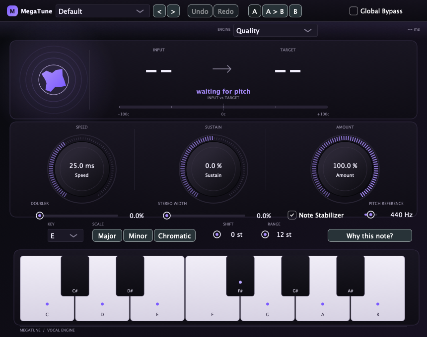
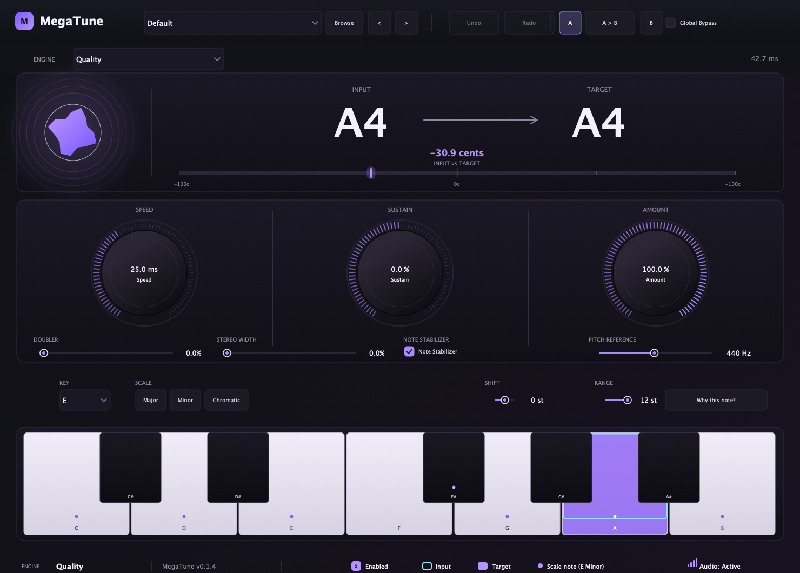
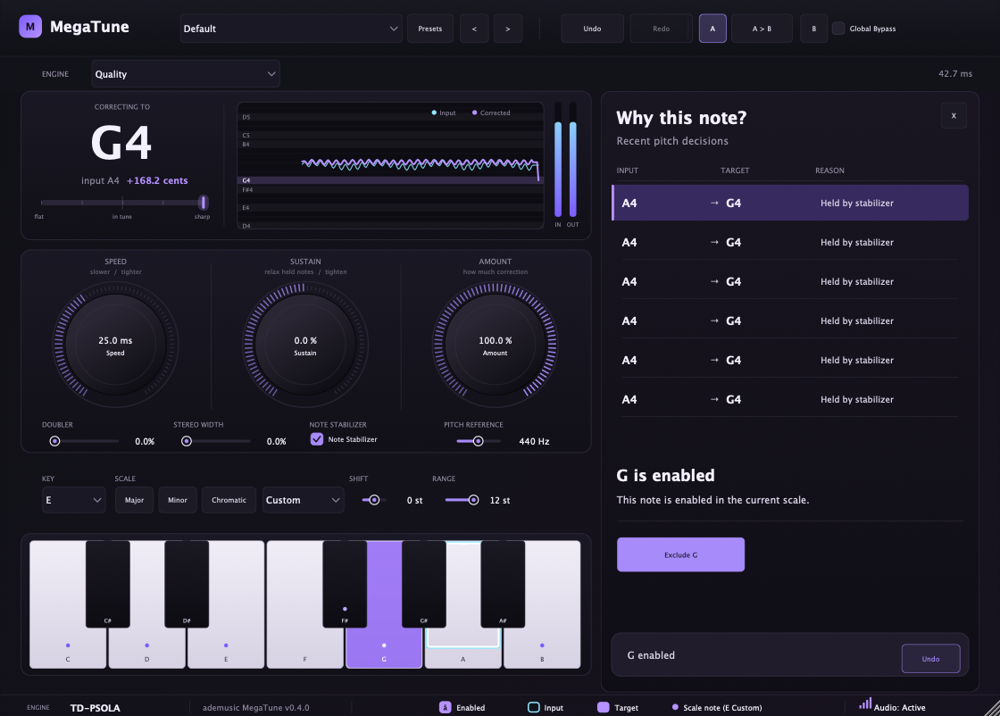
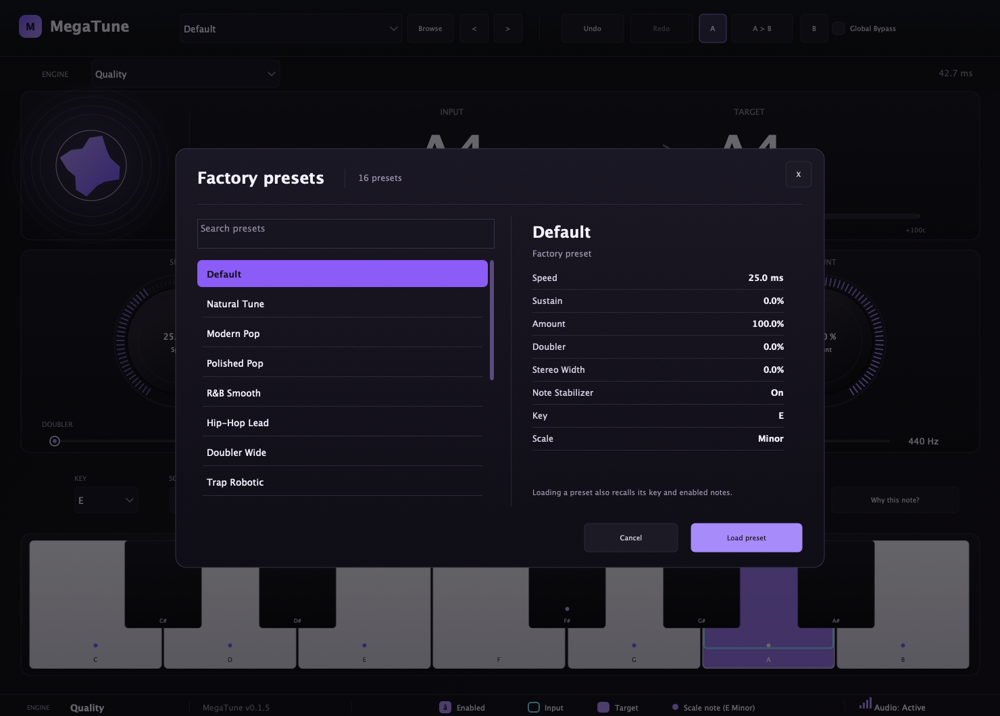

# ademusic MegaTune

A clean-room reconstruction of the **Slate Digital MetaTune** vocal tuner: a JUCE VST3 +
AUv2 plug-in with a live pitch monitor, a diagnostic "Why this note?" history, four
selectable pitch engines, factory presets and a fully themed editor.

> **Status: 0.3.0.** Pitch correction, latency reporting,
> presets, automation and the exclude/undo workflow are verified. **Formant preservation is
> unvalidated** and the build is **ad-hoc signed, not notarized**. See [Status](#status)
> before shipping anything.
>
> 0.3.1 reworks the audio path (sources only; rebuild with `app/vst3/build.sh` on macOS):
>
> - **Tuning**: Speed and Sustain now actually drive the default TD-PSOLA engine (the
>   ratio used to jump straight to the target, so the knob did nothing). The PSOLA engine
>   is stereo-linked with correlation-aligned pitch marks, the period is refined at full
>   sample rate on the audio leaving the shifter, and unvoiced audio passes through dry.
> - **Doubler**: two independently detuned and delayed voices instead of one static 18 ms
>   echo (which only comb-filtered the vocal).
> - **Stereo Width**: works on its own. It pans the doubled voices apart and adds a pure
>   side signal that widens a mono vocal and cancels completely in mono.
>
> Measured with `app/vst3/verify/bench.py` (synthetic vowel, ±35 cent vibrato): mean pitch
> error 24 cents in, about 1 cent out at Speed 0; Width 100 alone gives L/R correlation
> 0.49 with a mono-sum residual below −150 dB. Not yet auditioned on real vocals in a DAW.
>
> 0.3.0 makes the editor scale into a **resizable 1120×802 default window**
> (fixed aspect, minimum 740×530), so it fits Logic and smaller displays. The vendor/bundle
> identity is now **ademusic** (`AdMs`, `com.ademusic.megatune`).

---

## What this is (and is not)

This project began as a reverse-engineering exercise on a shipped plug-in and became an
independent implementation. It is **not** a crack, patch, or redistribution of Slate
Digital's product, and it contains **no original code or binaries**.

- The original `MetaTune.vst3` is **not** included in this repository. It is PACE-protected
  commercial software and is not redistributable.
- Control semantics (parameter ranges, default values, curve shapes) were recovered from
  the shipped binary by static inspection and are documented in
  [`app/MECHANICS.md`](app/MECHANICS.md), together with the evidence and the limits of
  what was recovered.
- The DSP is an independent implementation. It is **not** a clone of Slate's algorithm:
  the original pitch detector, formant handling, correction timing and doubler topology
  were never recovered.

`MegaTune` and `MetaTune` are referenced for identification only. All trademarks belong to
their owners.

---

## Features

| Area | What you get |
|---|---|
| Pitch engines | Quality (TD-PSOLA), Low Latency (TD-PSOLA, 512), Signalsmith Stretch |
| Controls | Speed, Sustain, Amount, Doubler, Stereo Width, Key, Scale, Shift, Range, Pitch Reference (A4) |
| Keyboard | One octave, scale membership dots, live input outline, target fill |
| Pitch monitor | Input → Target with signed cents and a ±100¢ meter |
| Diagnostics | "Why this note?" history of recent decisions with a one-click Exclude/Enable action |
| Presets | 16 factory programs with per-preset key and scale |
| Host integration | VST3 + AUv2; preset recall, parameter automation, Undo/Redo, A/B comparison, bypass |


---

## Engines and latency

| Engine | Latency @ 48 kHz | Notes |
|---|---|---|
| Quality | **2048 samples / 42.7 ms** | default; stereo TD-PSOLA with correlation-aligned marks |
| Low Latency | **512 samples / 10.7 ms** | same TD-PSOLA engine, shorter analysis window |
| TD-PSOLA | 2048 samples | pitch-synchronous overlap-add (also Low Latency) |
| Signalsmith | **5760 samples / 120 ms** | with optional formant compensation |

Declared latency matches measured impulse onset and cross-correlation lag at 44.1 and
48 kHz. A live engine switch republishes the correct latency on the next
`prepareToPlay`; whether a specific DAW re-reads compensation mid-session is **unverified**.

---

## Screenshots

| Idle | Active | History |
|---|---|---|
|  |  |  |

| Factory presets |
|---|
|  |

---

## Install

Version 0.1.6 (universal arm64 + x86_64, VST3 + AUv2):

https://github.com/ajdohaxhia/megatune/releases/tag/v0.1.6

```bash
# from the release archive or app/dist
open "Install MegaTune.command"     # or:
cp -R MegaTune.vst3 ~/Library/Audio/Plug-Ins/VST3/
cp -R MegaTune.component ~/Library/Audio/Plug-Ins/Components/
```

Then rescan plug-ins in your DAW. Use the VST3 in Ableton/Reaper/Cubase/Studio One and the
AUv2 component in Logic/GarageBand.

Uninstall: delete `~/Library/Audio/Plug-Ins/VST3/MegaTune.vst3` and
`~/Library/Audio/Plug-Ins/Components/MegaTune.component`.

---

## Build from source

Requirements: macOS, CMake ≥ 3.22, a C++17 toolchain, JUCE 8.0.x sources.

```bash
cd app/vst3
JUCE_DIR=/path/to/juce ./build.sh          # builds, runs ctest, packages and ad-hoc signs
```

Or manually:

```bash
cmake -S . -B build -DCMAKE_BUILD_TYPE=Release -DJUCE_DIR=/path/to/juce
cmake --build build -j 8
(cd build && ctest --output-on-failure)
```

Universal build:

```bash
cmake -S . -B build-universal -DCMAKE_BUILD_TYPE=Release -DJUCE_DIR=/path/to/juce \
      -DCMAKE_OSX_ARCHITECTURES="arm64;x86_64"
cmake --build build-universal -j 8
```

Signing for distribution (requires an Apple Developer ID — not available in this
environment):

```bash
codesign --force --deep --options runtime --sign "Developer ID Application: …" MegaTune.vst3
codesign --force --deep --options runtime --sign "Developer ID Application: …" MegaTune.component
xcrun notarytool submit MegaTune.zip --keychain-profile … --wait
xcrun stapler staple MegaTune.vst3
xcrun stapler staple MegaTune.component
```

---

## Testing

```bash
cd app/vst3/build-cli && ctest --output-on-failure     # in-process DSP + editor suite
```

The suite covers, among others:

- parameter landmarks from the recovered maps (Speed curve, Amount curve, defaults)
- state round-trip, bypass, latency-aligned dry path, preset navigation, A/B, Undo/Redo
- 16 presets render finite audio; per-preset key/scale application
- Range limiting, breath/uviolation gate, stereo-linked detection
- engine switching republishes latency (2048 ↔ 5760 ↔ 128)
- Signalsmith latency rescales after a 48 → 96 kHz sample-rate change
- 16384-sample host blocks stay inside the staging buffers
- a prepared analysis window performs no heap allocations
- held-target decisions are distinguished from fresh target changes
- Signalsmith obeys Global Bypass and still applies Doubler/Width
- host bypass stays latency-aligned at the Signalsmith latency, through 768 kHz
- negative Speed uses the hard-correction path
- Shift transposes independently when Amount is zero
- non-finite input, `reset()` and extra/mono channel buffers stay safe
- the engine × sample-rate × block-size matrix produces finite audio
- 4000-block engine/parameter churn remains finite
- **Why this note?** end-to-end: 432 Hz tone A4 → exclude A → G♯4 → Undo → A4
- 490 Hz disabled-target control (with and without Note Stabilizer)
- real-take target change: at 17.71 s of the dry fixture, excluding G retargets
  110/110 analysed blocks and Undo restores it bit-identically

Pluginval 1.0.4 at strictness 8 passes with its `Plugin state restoration` and
`Discrete parameter state restoration` tests disabled. Those two hit a known JUCE
host-proxy cache issue for discrete parameters: the plugin restores the correct
step, but the host-side proxy keeps the last random normalised value until its
next asynchronous refresh. An in-process test round-trips every parameter through
state instead.

Host-level checks (load, instantiate, parameters, audio, editor) run through
`app/vst3/host/`:

```bash
MegaTuneHostCheck /path/to/MegaTune.vst3
auval -v aufx Mgtn AdMs          # after installing the AU component
```

Measurement harnesses used during development live in `app/vst3/verify/`
(`formant_harness.py`, `paired2.py`, `score.py`, `measure.py`), plus `bench.py`, which
drives the in-process `MegaTuneBench` target to measure tuning error, doubler level and
stereo width / mono compatibility.

---

## Architecture

```
app/
  src/                 Rust/egui standalone prototype (historical)
  vst3/
    Plugin.cpp         processor + editor (single translation unit)
    TuningRules.h      recovered parameter curves (Speed, Amount, smoothing)
    TuningDsp.h        YIN detector, TD-PSOLA, helpers, diagnostic trace
    Tests.cpp          in-process regression suite
    CMakeLists.txt     JUCE plug-in target + tests
    build.sh           build + test + package + ad-hoc sign
    host/              VST3 host check, WAV renderer, latency probe
    verify/            measurement scripts and exported renders
    third_party/       vendored Signalsmith Stretch + Linear (MIT)
  dist/                installer, universal VST3 + AUv2, README
  MECHANICS.md         recovered semantics, evidence and open questions
```

### Audio path

1. Input is summed to mono for analysis, so both channels always share one correction target.
2. YIN detects F0 with aperiodicity; aperiodic frames pass through untouched (breath gate).
3. The nearest **enabled** scale degree becomes the target; the decision and its reason are
   recorded in a lock-free 16-entry ring.
4. Speed/Sustain shape a one-pole smoothing of the correction ratio.
5. The selected engine renders the shifted signal; Doubler and Width are applied after.

---

## Status

| Item | State |
|---|---|
| Pitch accuracy (synthetic vibrato) | ✅ 1.4¢ median / 1.4¢ p95 |
| Pitch accuracy (dry vocal) | ✅ 5.63¢ median, jumps 4.17 % |
| Low latency | ✅ 512 samples (10.7 ms); tunes 200 Hz correctly |
| Large host blocks / sample-rate changes | ✅ 16384-sample block and 48 → 96 kHz verified |
| Audio-thread allocations in analysis | ✅ none after prepare |
| Signalsmith bypass / doubler / latency | ✅ verified through 768 kHz |
| Negative Speed / zero-Amount Shift | ✅ verified |
| Non-finite input / reset / channel safety | ✅ verified |
| Long-session engine/parameter churn | ✅ 4000 blocks verified |
| AUv2 | ✅ `auval` passes |
| pluginval 1.0.4, strictness 8 | ✅ passes with two known JUCE state-cache tests disabled |
| Full parameter state round-trip | ✅ in-process regression |
| Why this note? → Exclude → Undo | ✅ verified on synthetic tone and on a real take |
| Presets, automation, recall, A/B | ✅ verified |
| **Formant preservation** | ❌ **unvalidated** — the estimator misclassifies known test cases |
| **DAW compatibility** | ❌ not tested in a real host |
| **Distribution signing** | ❌ ad-hoc only; no Developer ID in this environment |
| **Parity with the original DSP** | ❌ not attempted; documented as unknown |

Known engine limits: low notes below roughly 90 Hz exceed the analysis window; polyphonic
material is out of scope; formant behaviour is still unvalidated (measurement tooling).

---

## Licensing

- Project code: see `LICENSE` if present; otherwise all rights reserved by the author.
- **JUCE** — dual-licensed AGPLv3 / commercial. Building or distributing binaries requires
  compliance with one of those licences. This is the main release consideration.
- **Signalsmith Stretch** and **Signalsmith Linear** — MIT; vendored under
  `app/vst3/third_party/` with their licences and pinned revisions
  (`88061fd4…` and `7bb1c8f3…`, tag 0.6.6).

---

## Roadmap

1. A formant estimator that classifies known-drift fixtures correctly, then re-score
   TD-PSOLA and Signalsmith at ±3/±6 semitones.
2. Verify host latency re-compensation when switching engines during playback.
3. DAW compatibility matrix (Logic, Ableton, Reaper, Cubase) and long-session stability.
4. Developer ID signing + notarization for public distribution.

---

*Built with the DeepSeek Harness, JUCE 8.0.15 and Signalsmith Stretch. Every numeric claim
above is reproducible from the scripts in `app/vst3/verify/`.*
